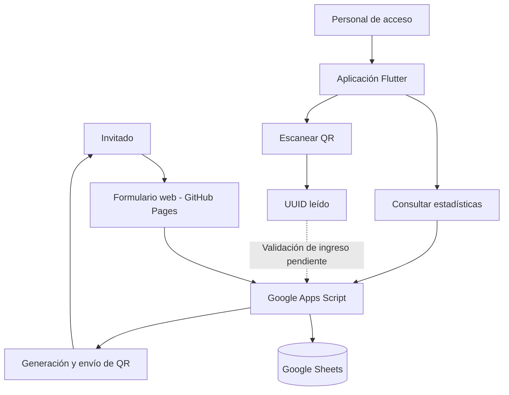

# 🎟️ Registro de Eventos 2.0


Sistema de **registro de invitados y control de acceso mediante códigos QR**, desarrollado con **Flutter**, **Google Apps Script**, **Google Sheets** y **GitHub Pages**.

🌐 **[Abrir formulario de registro](https://julianvillasenor.github.io/registro_eventos/)**

---

## 📌 ¿Qué hace el proyecto?

Permite registrar invitados desde una página web, almacenar sus datos en Google Sheets, generar un código QR único para cada registro y leerlo desde una aplicación móvil durante un evento.

El proyecto se compone de tres partes:

| Componente | Tecnología | Función |
|---|---|---|
| 🌐 Landing page | HTML, CSS, JavaScript, GitHub Pages | Formulario de registro |
| ⚙️ Backend | Google Apps Script + Google Sheets | Procesamiento y almacenamiento de registros |
| 📱 Aplicación móvil | Flutter + Dart | Estadísticas y escaneo de códigos QR |

## 🏗️ Arquitectura



## 🔄 Flujo de registro

1. El invitado entra a la **[página de registro](https://julianvillasenor.github.io/registro_eventos/)**.
2. Introduce su **nombre** y **correo electrónico**.
3. La página envía los datos a **Google Apps Script**.
4. El backend guarda el registro en **Google Sheets** y le asigna un **UUID**.
5. Se genera un **código QR** asociado al identificador, que puede enviarse por correo.
6. Durante el evento, el personal puede leer el QR con la aplicación Flutter.

### Formato del QR

```text
EVT:<UUID>
```

Ejemplo de formato:

```text
EVT:xxxxxxxx-xxxx-xxxx-xxxx-xxxxxxxxxxxx
```

## 🗃️ Estructura de Google Sheets

La hoja de invitados contempla los siguientes campos:

| Campo | Descripción |
|---|---|
| `id` | Identificador único UUID |
| `nombre` | Nombre del invitado |
| `email` | Correo electrónico |
| `fecha_registro` | Fecha y hora de registro |
| `ingreso` | Indicador de asistencia (`TRUE` / `FALSE`) |
| `fecha_ingreso` | Fecha y hora del acceso |

> **Nota:** La actualización automática de `ingreso` y `fecha_ingreso` a partir del escaneo es una funcionalidad pendiente de integrar y verificar de extremo a extremo.

## 📱 Aplicación Flutter

La aplicación está orientada al personal encargado del acceso al evento.

**Pantalla principal:** muestra las estadísticas de invitados registrados e ingresados, consultadas desde el backend.

**Escáner QR:** utiliza la cámara del teléfono para leer el identificador del invitado. Actualmente muestra el contenido escaneado.

**Últimos accesos:** sección visual que por ahora utiliza registros de demostración.

### Dependencias principales

- [`http`](https://pub.dev/packages/http): solicitudes HTTP al backend.
- [`mobile_scanner`](https://pub.dev/packages/mobile_scanner): lectura de códigos QR.

## 📁 Estructura del repositorio

```text
registro_eventos/
├── .github/
│   └── workflows/
│       └── static.yml       # Publicación de GitHub Pages
├── android/                 # Proyecto Android
├── ios/                     # Proyecto iOS
├── lib/
│   ├── main.dart            # Entrada de la aplicación
│   ├── models/
│   │   └── estadisticas.dart
│   ├── screens/
│   │   ├── home_screen.dart
│   │   └── qr_screen.dart
│   ├── services/
│   │   └── api_service.dart
│   └── theme/
│       └── app_theme.dart
├── landing/                 # Formulario web
├── apps_script/             # Código del backend
├── pubspec.yaml
├── pubspec.lock
└── README.md
```

## 🚀 Instalación

### Requisitos

- Flutter SDK (migración probada con **3.47.9**).
- Dart SDK (migración probada con **3.13.7**).
- Android SDK y un dispositivo Android o emulador.
- Visual Studio Code o Android Studio (opcional, recomendado).

### 1. Clonar el proyecto

```bash
git clone https://github.com/JulianVillasenor/registro_eventos.git
cd registro_eventos
```

### 2. Instalar dependencias

```bash
flutter pub get
```

### 3. Verificar el código

```bash
flutter analyze
```

### 4. Ejecutar en Android

```bash
flutter devices
flutter run
```

Para elegir un dispositivo específico:

```bash
flutter run -d <DEVICE_ID>
```

## ⚙️ Configuración del backend

Para desplegar una instalación propia:

1. Crear una hoja de cálculo con las columnas descritas arriba.
2. Crear un proyecto en **Google Apps Script**.
3. Incorporar y adaptar el código de `apps_script/`.
4. Configurar la hoja de cálculo y desplegar el script como aplicación web.
5. Configurar la URL del despliegue en la landing y en `lib/services/api_service.dart`.
6. Probar el registro, las estadísticas y la generación del QR.

> **Importante:** GitHub Pages publica la página web, pero **no despliega automáticamente Google Apps Script**. Los cambios del backend deben publicarse por separado.

## 📊 Estado de funcionalidades

| Funcionalidad | Estado |
|---|---|
| Formulario de registro en GitHub Pages | ✅ Funcional |
| Almacenamiento de invitados en Google Sheets | ✅ Funcional |
| Generación y envío de QR | ✅ Probado |
| Panel de estadísticas Flutter | ✅ Implementado |
| Lectura de QR en Android | ✅ Probada |
| Validación del UUID contra la hoja al escanear | 🚧 Pendiente |
| Marcar ingreso y registrar fecha automáticamente | 🚧 Pendiente |
| Bloqueo de ingresos duplicados | 🚧 Pendiente |
| Historial real de últimos accesos | 🚧 Pendiente |

## 🔐 Seguridad y privacidad

- No publicar credenciales ni información personal de invitados en el repositorio.
- Validar los ingresos **en el backend**, no únicamente en la aplicación móvil.
- Considerar que un UUID en un QR identifica un registro, pero **no autentica por sí solo a la persona**.
- Configurar permisos adecuados para Google Sheets y Apps Script.

## 🔗 Enlaces

- **Repositorio:** [JulianVillasenor/registro_eventos](https://github.com/JulianVillasenor/registro_eventos)
- **Formulario:** [Registro de Eventos](https://julianvillasenor.github.io/registro_eventos/)

---

**Registro de Eventos 2.0** · Flutter · Google Apps Script · Google Sheets · GitHub Pages
